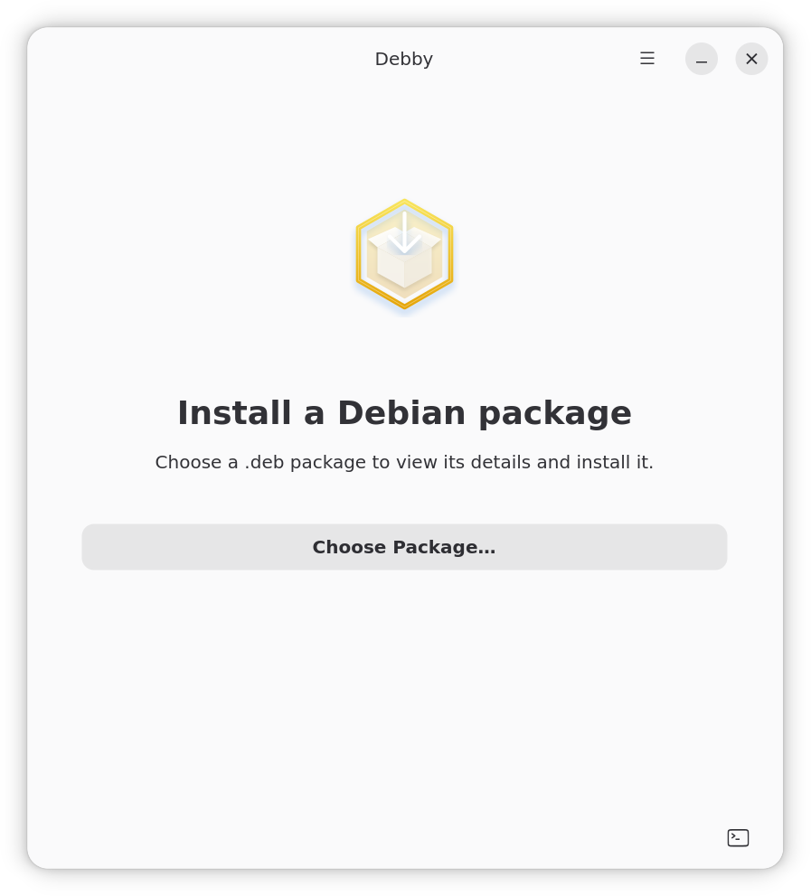

# Debby

Debby is a graphical installer for local Debian (`.deb`) packages, built with
Rust, GTK 4, and libadwaita. It lets you review a package's name, version, and
description before installing it, with support for upgrading or reinstalling
packages that are already installed.



## Build a Debian package

Install Rust/Cargo and the native build dependencies listed below. Packaging
also requires `dpkg-dev`, `gettext`, and `blueprint-compiler`:

```sh
sudo apt install dpkg-dev gettext blueprint-compiler
bash scripts/build-deb.sh
```

The script builds a native release binary and writes
`dist/debby_<version>-1_<architecture>.deb`. Pass an output directory as its
first argument, or set `DEB_MAINTAINER='Your Name <you@example.com>'` and
`DEB_REVISION=2` to customize the package metadata. It bundles the desktop
entry, icon, and compiled translations, and derives shared library dependencies
with `dpkg-shlibdeps`. Build on the Debian/Ubuntu release you intend to support.

Install the resulting package with `sudo apt install ./dist/debby_*.deb`.

Build dependencies:

```sh
sudo apt install build-essential libgtk-4-dev libadwaita-1-dev pkg-config blueprint-compiler gettext
cargo run
```

English is the source and fallback language. Gettext selects translations using
the system locale (`LC_ALL`, `LC_MESSAGES`, `LANG`) and `LANGUAGE`. Serbian
(Cyrillic) is provided in `po/sr.po`; the translation template is `po/debby.pot`.
Both Rust and Blueprint strings use the `debby` gettext domain. Package metadata
and command output are supplied by dpkg/apt and retain their own language.

Builds compile the languages in `po/LINGUAS` into Cargo's output directory so
translations work with `cargo run`. The Debian builder configures the packaged
binary to use `/usr/share/locale`. For other installation layouts, set
`DEBBY_INSTALL_LOCALEDIR` at build time and install catalogs as
`<locale-dir>/<language>/LC_MESSAGES/debby.mo`. `DEBBY_LOCALEDIR` overrides the
directory at runtime.

Regenerate the POT and update the PO catalogs after changing UI strings:

```sh
sh po/update-translations.sh
```

Examples (use an installed UTF-8 locale):

```sh
LANGUAGE=en cargo run
LANGUAGE=sr cargo run
```
