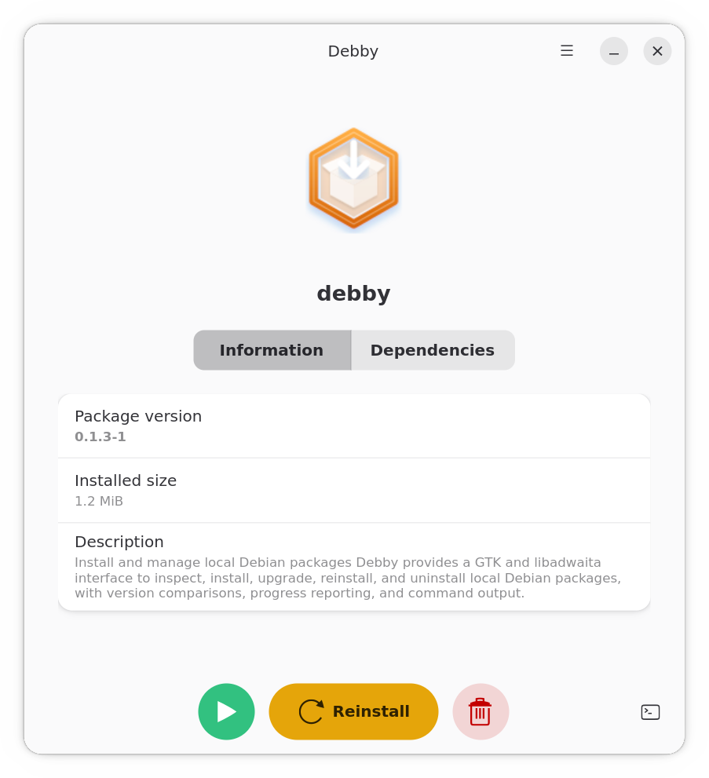

# Debby

Debby is a simple graphical installer for local Debian (`.deb`) packages, built with
Rust, GTK 4, and libadwaita. It lets you review a package's name, version, and
description before installing it, with support for upgrading or reinstalling
packages that are already installed.



## Build amd64 and arm64 packages with Docker

On an amd64 Linux PC, use Docker Engine with the Buildx plugin and a
`docker-container` builder. No host Rust or GTK development packages are needed.
The script uses Docker (not Podman), your selected builder, and its configured
Docker context. It never installs tools, registers emulators, or creates builders.

For ARM64 emulation, configure QEMU/binfmt once if your builder does not already
provide it. **The following optional command is privileged and changes the host's
binfmt registrations; run it only if you trust the image and approve that change:**

```sh
docker run --privileged --rm tonistiigi/binfmt --install arm64
```

Create and select a builder once (choose another name if this one exists), or
select an existing suitable builder with `docker buildx use <name>`:

```sh
docker buildx create --name debby-builder --driver docker-container --use
docker buildx inspect --bootstrap
```

Check that the reported platforms include `linux/amd64` and `linux/arm64`, then:

```sh
bash scripts/build-multiarch.sh
bash scripts/build-multiarch.sh --arch arm64 --output './packages for arm64'
DEB_REVISION=2 DEB_MAINTAINER='Your Name <you@example.com>' bash scripts/build-multiarch.sh --arch all
bash scripts/build-multiarch.sh --help
```

`--arch` accepts `amd64`, `arm64`, or `all` (the default). Output defaults to the
project's `dist/`; explicit relative output paths are relative to your current
working directory. Buildx exports the scratch `artifacts` stage into temporary
platform directories (`linux_amd64/` and `linux_arm64/`). The script checks for
one package per requested architecture, then flattens them into the output:

```text
dist/debby_<version>-<revision>_amd64.deb
dist/debby_<version>-<revision>_arm64.deb
```

Existing packages with identical names are replaced; unrelated files are not
removed. The temporary export is cleaned up on exit. Only `.deb` artifacts are
exported, not an image to load or push. The local exporter writes host-user-owned
files; no host `sudo`, `chmod`, or `chown` is needed by the script.

The Dockerfile uses official `rust:1-trixie` (a floating Rust 1.x toolchain with
Rust 2024 edition support) and Debian trixie's GTK/libadwaita development packages.
Bookworm's libadwaita is too old for this project's `v1_5` requirement. Each target
runs the existing native `scripts/build-deb.sh`, including Blueprint, gettext,
and `dpkg-shlibdeps`, under QEMU when necessary; this is not Cargo cross-compilation.
Cargo registry, Git, and build caches are separated by target architecture.
Host `target/`, `dist/`, and `.git/` are excluded from the build context. Keep any
custom output directory outside the source tree to avoid sending old artifacts
in subsequent builds.

Builds require network access for container images, Debian packages, and Cargo
crates. Initial ARM64 builds under emulation can be slow and memory-intensive.
Base images and apt packages float, so builds are not bit-for-bit reproducible.
These packages target **Debian trixie**, not every Debian/Ubuntu release: install
only the package matching the destination machine's architecture, on a system
providing the generated shared-library dependencies and libadwaita >= 1.5.
Older distributions (including bookworm) are not supported by these artifacts;
Ubuntu compatibility depends on its available library versions.

## Build a native Debian package

Install Rust/Cargo and the native build dependencies listed below. Packaging
also requires `dpkg-dev`, `gettext`, and `blueprint-compiler`:

```sh
sudo apt install dpkg-dev gettext blueprint-compiler
bash scripts/build-deb.sh
```

The script builds a native release binary and writes
`dist/debby_<version>-1_<architecture>.deb`. Pass an output directory as its
first argument, or set `DEB_MAINTAINER='Your Name <you@example.com>'` and
`DEB_REVISION=2` to customize the package metadata. It bundles the desktop
entry, icon, and compiled translations, and derives shared library dependencies
with `dpkg-shlibdeps`. Build on the Debian/Ubuntu release you intend to support.

Install the resulting package with `sudo apt install ./dist/debby_*.deb`.

Build dependencies:

```sh
sudo apt install build-essential libgtk-4-dev libadwaita-1-dev pkg-config blueprint-compiler gettext
cargo run
```

English is the source and fallback language. Gettext selects translations using
the system locale (`LC_ALL`, `LC_MESSAGES`, `LANG`) and `LANGUAGE`. Translations
are provided for Arabic (`ar`), Bengali (`bn`), German (`de`), Spanish (`es`),
French (`fr`), Hindi (`hi`), Indonesian (`id`), Italian (`it`), Japanese (`ja`),
Korean (`ko`), Brazilian Portuguese (`pt_BR`), Russian (`ru`), Serbian (Cyrillic,
`sr`), Turkish (`tr`), Ukrainian (`uk`), and Simplified Chinese (`zh_CN`).
Catalogs are in `po/<language>.po`; the translation template is `po/debby.pot`.
Both Rust and Blueprint strings use the `debby` gettext domain. Package metadata
and command output are supplied by dpkg/apt and retain their own language.

Builds compile the languages in `po/LINGUAS` into Cargo's output directory so
translations work with `cargo run`. The Debian builder configures the packaged
binary to use `/usr/share/locale`. For other installation layouts, set
`DEBBY_INSTALL_LOCALEDIR` at build time and install catalogs as
`<locale-dir>/<language>/LC_MESSAGES/debby.mo`. `DEBBY_LOCALEDIR` overrides the
directory at runtime.

Regenerate the POT and update the PO catalogs after changing UI strings:

```sh
sh po/update-translations.sh
```

Examples (use an installed UTF-8 locale):

```sh
LANGUAGE=en cargo run
LANGUAGE=sr cargo run
```
